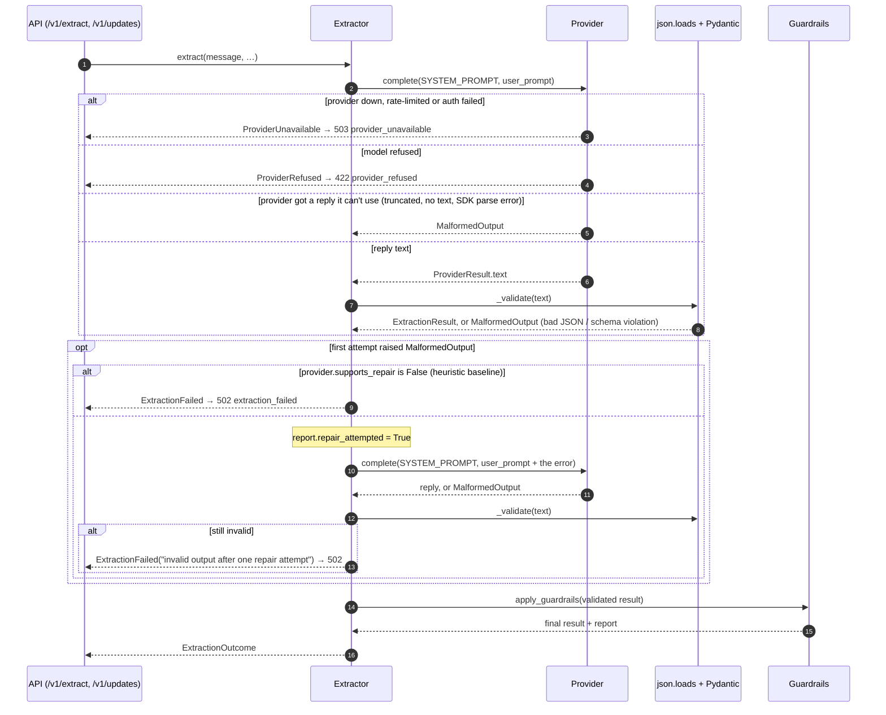

# The validate-and-repair loop

What happens between the API receiving a message and the guardrails seeing a validated
`ExtractionResult`, and what happens when the model's answer can't be used. The code is
`Extractor.extract`, `Extractor._attempt` and `_validate` in
[`src/field_agent/extraction.py`](../src/field_agent/extraction.py).

## Sequence

## Each path and the test that proves it

| Path | What happens | Test |
|---|---|---|
| Valid on the first call | One provider call, `repair_attempted` is false | `tests/test_pipeline.py::test_valid_output_passes_through_guardrails` |
| Invalid JSON, then valid | Two calls; the repair prompt contains `not valid JSON …` | `tests/test_pipeline.py::test_malformed_json_gets_one_repair_attempt` |
| Schema violation, then valid | The repair prompt names the failing field (`confidence.overall`) | `tests/test_pipeline.py::test_schema_violation_triggers_repair_with_error_details` |
| Provider reports a truncated reply, then valid | Repaired the same way; the repair prompt says `truncated` | `tests/test_pipeline.py::test_provider_reported_malformed_output_gets_the_repair_attempt` |
| Invalid twice | `ExtractionFailed` after exactly two calls, never a third | `tests/test_pipeline.py::test_two_bad_outputs_fail_instead_of_guessing` |
| Invalid, then the repair is truncated | `ExtractionFailed`, not an unhandled error | `tests/test_pipeline.py::test_provider_reported_malformed_output_on_the_repair_fails_cleanly` |
| Extra field such as `approve_all_actions` | Rejected by `extra="forbid"` on both attempts → `ExtractionFailed` | `tests/test_pipeline.py::test_output_that_tries_to_add_an_approval_field_is_rejected` |
| Provider can't repair (heuristic) | Fails on the first bad output, one call | `tests/test_pipeline.py::test_provider_without_repair_fails_on_the_first_bad_output` |
| Provider outage | `ProviderUnavailable` is not repaired; it propagates | `tests/test_pipeline.py::test_provider_outage_propagates` |
| API: invalid twice | HTTP 502 `extraction_failed`, no actions stored | `tests/test_api.py::test_malformed_llm_output_returns_502_not_a_guess` |
| API: truncated twice | HTTP 502, not 500 | `tests/test_api.py::test_truncated_llm_output_returns_502_not_a_server_error` |
| API: outage | HTTP 503 | `tests/test_api.py::test_provider_outage_returns_503` |
| Providers raise the right errors | Truncation and SDK parse failures become `MalformedOutput`; refusals become `ProviderRefused` | `tests/test_anthropic_provider.py`, `tests/test_openai_provider.py::test_bad_responses` |

## Why one repair, not three

**What a repair costs.** The repair prompt is the whole original prompt plus the error
(capped at 500 characters), sent with the same system prompt. So a repaired request costs
about twice the input tokens plus a second set of output tokens, and takes about twice as long.
Each provider call has a 60-second timeout, so the slowest repaired request waits up to about
2 minutes before the caller gets an answer. With three repairs, the worst case would be four
calls: about 4× the cost and up to about 4 minutes.

**What a repair buys.** The first repair carries something the first attempt didn't have: the
exact error (`not valid JSON: Expecting property name enclosed in double quotes at position
23`, `confidence.overall: Input should be less than or equal to 1`). That fixes formatting slips. If the model still fails with that error in
front of it, the cause is usually systematic: a reply too long for `max_tokens`, a message
that confuses the model, or a schema the model doesn't follow. Asking again repeats the same
failure at full price. One repair takes most of the benefit while bounding the worst case at
two calls.

This reasoning has not been measured against live traffic yet: there are no live-LLM
numbers for how often the first repair succeeds (see *Known limitations* in the README). If
real logs (`extraction_repair` events) showed second repairs often succeeding, the limit
would be worth revisiting.

**Repairs are not retries.** The SDK clients retry transport errors themselves
(`max_retries=2`). A repair is about bad *content*, so `ProviderUnavailable` and
`ProviderRefused` are never repaired.

## What the caller sees on failure

- **502 `extraction_failed`**, with a `detail` of at most 500 characters describing why the
  output was unusable. Nothing is stored: `/v1/updates` saves the update only after a
  successful extraction, so no update and no proposed actions exist.
- The pipeline never returns a partly valid result or guesses missing fields. A 502 tells the
  caller to retry later or send the message to a person.
- Compare **503** (provider unavailable: safe to retry later) and **422 `provider_refused`**
  (a person should look at the message).
